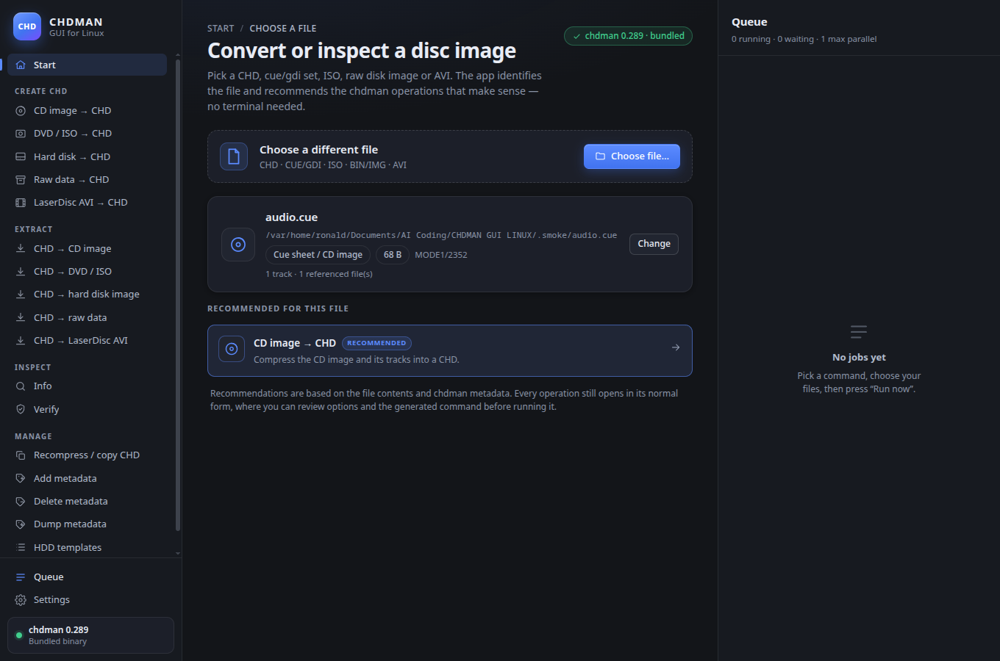

# CHDMAN GUI for Linux

A desktop front-end for **chdman**, MAME's Compressed Hunks of Data (CHD) manager,
made for people who just want to move disc images between formats without
opening a terminal. Built with Electron, React and TypeScript and distributed
as a **self-contained Flatpak**: the app, chdman itself and every library chdman
needs are shipped inside the bundle, so it runs on any distribution without
installing MAME, SDL3 or FLAC.



More screenshots: [HDD templates](docs/screenshot-templates.png) ·
[Settings](docs/screenshot-settings.png)

## Why this exists

chdman is capable, but it is a command-line-only utility. Someone who simply
wants to turn a `.cue`, `.gdi` or `.iso` into a `.chd` — or get their files back
out again — first has to find the right command, remember the argument order,
and follow progress scrolling past in a terminal. This project removes that
barrier: choose the conversion, pick the input and output files, press Run.
The app builds the arguments, shows progress, verifies results and keeps
finished jobs visible in the queue, so converting between disc-image formats is
a few clicks on the desktop instead of a command-line exercise. The engine
ships with the app, so there is no separate MAME install to manage either.

## Install (Flatpak)

Download `CHDMAN-GUI-<version>-x86_64.flatpak` from the latest GitHub release:

```bash
flatpak install --user ./CHDMAN-GUI-0.1.0-x86_64.flatpak
flatpak run io.github.shadowtheimpure.CHDMANGUI
```

The bundle is built against `org.freedesktop.Platform//24.08` and
`org.electronjs.Electron2.BaseApp//24.08`. If they are not installed yet,
`flatpak install` offers to fetch them from Flathub (add the remote once with
`flatpak remote-add --if-not-exists --user flathub https://flathub.org/repo/flathub.flatpakrepo`).

## Features

- **Every chdman command**: `info`, `verify`, `createraw`, `createhd`, `createcd`,
  `createdvd`, `createld`, `extractraw`, `extracthd`, `extractcd`, `extractdvd`,
  `extractld`, `copy`, `addmeta`, `delmeta`, `dumpmeta`, `listtemplates`.
- **Guided forms** generated from a single command schema: file pickers, drag &
  drop, byte/size parsing (`20M` → `20971520`), required-field validation, and
  sensible output names derived from the input file.
- **Job queue** with real progress percentages, current phase and compression
  ratio, 1–4 parallel jobs, cancel/retry/remove, and "reveal output" on success.
- **Live logs** per job — filterable, timestamped, copyable and saveable.
- **Structured `info` results**: media type, CHD format version, logical/CHD
  size, ratio, SHA-1s, every header field and the raw metadata block.
- **HDD template browser** for `createhd --template`, with one-click hand-off to
  the Create Hard Disk form.
- System/dark/light themes, persisted settings and window geometry.
- **Bundled chdman 0.289** with automatic fallback to `$CHDMAN_PATH` or `PATH`.

## Requirements

- x86_64 Linux with Flatpak 1.12+ (Flatpak itself provides the runtime and all
  libraries; no MAME, SDL3 or FLAC installation is needed).
- Node.js 20+ and npm only for building from source.

## Run from source

```bash
npm install
npm run dev          # Vite + Electron with hot reload
```

Production-style run (builds the renderer, then launches Electron):

```bash
npm start
```

## Build the Flatpak

```bash
./scripts/build-flatpak.sh
```

This packages the app with electron-builder and wraps it with flatpak-builder
(using `org.flatpak.Builder` when `flatpak-builder` is not installed on the
host). The result is `release/CHDMAN-GUI-<version>-x86_64.flatpak`.

## Optional: AppImage

```bash
npm run dist
```

The AppImage is written to `release/`. It bundles `vendor/chdman` and its
libraries too, but — unlike the Flatpak — it still relies on the host glibc and
desktop stack. The bundled engine only needs glibc 2.34, so the AppImage works
on Ubuntu 22.04+, Debian 12+, Fedora 36+, RHEL 9+ and newer.

## The bundled engine

`vendor/chdman/bin/chdman` is MAME 0.289 **built from source** inside an Ubuntu
22.04 container with GCC 12. Its third-party codecs (zlib, zstd, FLAC,
utf8proc, expat, 7-Zip) are statically linked, and `libSDL3`, `libstdc++` and
`libgcc_s` ship next to it. The binary only requires glibc 2.34 symbols.

The app resolves the engine in this order and verifies it by running it:

1. the custom path set in **Settings**,
2. the `CHDMAN_PATH` environment variable,
3. the bundled binary in `vendor/chdman/bin/chdman`,
4. `chdman` found in `PATH`.

Libraries are injected with `LD_LIBRARY_PATH` **only for the chdman child
process**, never for Electron itself. See
[`vendor/chdman/README.md`](vendor/chdman/README.md) for provenance and
licensing. To rebuild it:

```bash
./scripts/build-engine.sh      # needs podman; builds chdman + SDL3 in Ubuntu 22.04
```

## Keyboard shortcuts

| Shortcut | Action |
| --- | --- |
| `Ctrl+Enter` | Run the current form immediately |
| `Enter` | Submit the form (add to queue) |
| `Esc` | Close the log/summary dialog |

## Project layout

```
electron/main.js              Main process: engine discovery, job spawning, IPC
electron/preload.js           contextBridge API (sandboxed renderer)
src/lib/commands.ts           Schema for every chdman command → forms + argv
src/lib/info.ts               Parsers for `info` and `listtemplates` output
src/hooks/useQueue.ts         Queue state machine, progress/log streaming
src/components/               UI: sidebar, forms, queue, dialogs, settings, templates
flatpak/                      Flatpak manifest, desktop entry, AppStream metadata
scripts/dev.mjs               Dev launcher (Vite + Electron)
scripts/smoke-ui.mjs          End-to-end UI test over the DevTools protocol
scripts/build-engine.sh       Rebuild the distro-agnostic chdman engine
scripts/build-flatpak.sh      Build the release Flatpak bundle
vendor/chdman/                Bundled chdman + libSDL3 + GCC runtime
```

## Testing

```bash
npm run smoke
```

This creates `.smoke/` fixtures, launches the built app with the DevTools
protocol enabled, drives the real UI to create a CHD, inspect it, extract it
back, and screenshots each step. It exits non-zero on any failure.

CI runs the same smoke test and then builds the Flatpak on every push
(`.github/workflows/build.yml`). Pushing a tag such as `v0.1.0` attaches the
resulting `.flatpak` bundle to the GitHub release.

## Troubleshooting

- **`--ozone-platform=wayland is not compatible with Vulkan`** — harmless
  Chromium notice on Wayland; Electron falls back to software/GL rendering.
- **Electron will not start on an immutable distro (sandbox error)** — run
  `ELECTRON_NO_SANDBOX=1 npm run dev` for source builds.
- **Flatpak cannot see a file** — the bundle requests host filesystem access
  (`--filesystem=host`) because chdman reads and writes multi-file images
  anywhere on disk. You can restrict it with
  `flatpak override --user --nofilesystem=host io.github.shadowtheimpure.CHDMANGUI`
  and grant individual folders instead.
- **Output already exists** — chdman refuses to overwrite by default. Enable
  *Overwrite existing output* (`--force`) in the form.
- **"chdman not found"** — open Settings and either let it use the bundled
  binary or point to an installed `chdman` (`mame-tools` on Fedora/Ubuntu).

## AI usage disclosure

This project was developed with substantial AI assistance, disclosed here so
users can weigh that accordingly.

- The application code (Electron main/renderer process, React UI, build and
  packaging scripts), the end-to-end test and this documentation were written
  collaboratively by the maintainer and AI coding agents — primarily
  **DeepSeek V4.1 Flash** running in the OpenCode agent harness — under the
  maintainer's direction and review.
- The bundled `chdman` is **not** AI-generated. It is unmodified upstream
  MAME 0.289 source compiled from the official release, with SDL3 from
  upstream SDL and the GCC runtime from Ubuntu.
- AI-assisted code can contain mistakes. The app is exercised by an automated
  UI test that creates, inspects and extracts real CHD files, but it is
  provided as-is under the license below. Please report bugs through the issue
  tracker instead of assuming any behaviour is authoritative.

The human maintainer remains responsible for the repository, releases and
correctness decisions.

## Licensing

This front-end is MIT-licensed. chdman is part of MAME (GPL-2.0-or-later);
SDL3 is Zlib; `libstdc++`/`libgcc` carry the GCC runtime exception; statically
linked codecs keep their own licenses. If you redistribute the Flatpak or
AppImage, keep their licenses and source availability with it.
